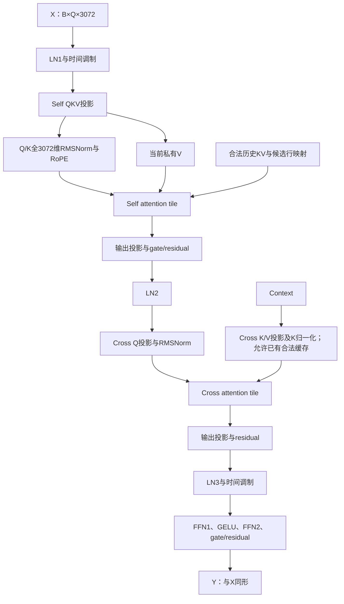

# 按Transformer依赖设计self/cross-attention tile子图

2026-10-19，CPU设计修订，无新GPU实验。用户指出前版过度以FFN/MegaMoE为中心；本页替代[前版FFN-first建议](DESIGN.md)的整体推进顺序。MegaMoE只提供常驻任务和依赖调度思想，子图根据当前Transformer源码拆分。FFN原型仍有局部价值，不能代表整体设计或阻塞attention侧研究。

## 1. 三个子图与完整依赖

实际顺序来自`算子研究/wam_ops/baseline/csrc/block.cu:278–309`：



这是有条件分支和就绪关系的DAG，不是可以任意交换的三个模块。context K/V准备在条件和权重已确定时可以提前；cross Q必须等待对应行的self输出及LN2。

## 2. attention tile怎样定义

建议首版常驻worker领取一个**输出query tile任务**，身份为`layer, self/cross, CFG/condition_group, candidate_group, head, query_rows, KV_view, output_slot, generation`。任务内部保持完整的Flash式计算：

```text
Q tile
  对合法KV tile逐块迭代：
    QKᵀ → mask → online softmax状态更新 → PV累积
  全部KV完成 → normalize → 按原边界舍入/存储输出
```

QK、softmax、PV是同一attention任务内部的协作阶段。运行最大值、归一化和、输出累加器保持在任务内部，不为队列调度物化完整score/probability矩阵。首版不将每个QK乘法或每个KV片段都放入全局任务队列；更细拆分需要保存在线状态、正确归并及数值重验。

本项目action每候选Q16、24 heads、head_dim128：单KV块计算形状是`[Bq,128]×[128,Bk]`，再与`[Bk,128]`的V相乘。`Bq/Bk`是执行tile尺寸，不能与候选数或任务action horizon混用。原逻辑Q16不足tile时有无效行；以真实kernel/profile决定是否分组，不能只看几何比例宣布收益。

现有实现已经tile化：`optimized/csrc/attention.cu:26`的standard配置为head128、query tile128、KV tile64、4 warp；split路径为query64、KV128，并有显式combine。`candidate_attention.cu:10`采用query64/KV64、4 warp，已有G1/G2/G4入口。新工作的增量应是设备tile可领取任务、与相邻节点的ready/生命周期协作及其性能证据，不是首次“把attention变成tile”。

## 3. self与cross的不同契约

| 项目 | Self-attention子图 | Cross-attention子图 |
|---|---|---|
| Q来源 | 当前hidden的Q投影、全D RMSNorm、RoPE | self输出经LN2、Q投影、全D RMSNorm |
| K/V来源 | 既有合法历史＋当前候选自己的私有K/V | context投影；K另有全D RMSNorm |
| 当前action有效K | 288/1152/2160 | 512 |
| 可共享范围 | 实际同CFG历史；当前private KV按候选隔离 | 经身份/数值核验相同的condition投影；不默认跨CFG共享 |
| 首版tile任务 | 单head/query行块，遍历合法history/private KV | 单head/query行块，遍历固定context KV |
| 主要机会 | 合法公共history复用、避免打包复制、就绪调度 | Q侧与固定条件KV配合、任务成本更规则、向输出投影传递ready |

跨候选query物理分组时，每行仍只看自己的private KV。现有G2/G4通过visibility规则屏蔽其他候选私有段；7候选不是任意互相注意的Q112序列。当前guard还考虑分组后KV尾块增加的成本，不能忽略现成强baseline。

现有cross缓存保存原形状K/V Linear输出，norm_k仍有自身计算；若进一步缓存归一化K，需明确新缓存内容/生命周期、BF16一致性和失效条件。不能把未实现的额外缓存收益算到已有baseline，也不能把缓存本身当新调度贡献。

## 4. 必须遵守的就绪边界

- **Q/K归一化前：** 当前RMSNorm跨完整3072维，不是各head128维独立归约。对应行的所有投影列必须就绪，才能完成归一化并释放head任务。
- **self attention前：** query行已经完成RMSNorm/RoPE，且该候选可见的全部当前私有K/V满足任务读取顺序；非因果attention会看当前16 token，不能仅用同一query行就绪替代全部私有K/V依赖。历史视图、有效slot和版本先固定。
- **输出投影前：** 一个query行块的24个head输出共同组成3072维归约输入。首版等该行块全部head完成，再释放Wo tile；不能一个head刚结束就把它当完整投影输入。以后研究K片段归约仍需保持原算术契约。
- **下一段norm前：** 输出投影全部列和残差完成后，才能做该行的完整D归约并生成cross Q或FFN输入。
- **跨阶段常驻：** consumer不占住全部CTA等待尚未运行的producer。只领取已就绪工作，发布/获取、generation和workspace释放有明确协议。

## 5. persistent执行器如何服务Transformer

常驻CTA是资源容器，warp/warp组协作执行当前任务。统一任务描述可以覆盖GEMM tile、全行norm、attention输出tile、pointwise，但不要求它们使用同一tile尺寸或同一warp数量。

第一阶段保持已有Flash任务内部MMA、softmax和KV遍历顺序，改造为显式任务坐标入口并比较固定grid与常驻领取。现成kernel依赖blockIdx、资源特征和特定循环，不能直接把host launch包进device while循环。

下一阶段才逐步加入`QKV准备→self attention→Wo/residual`的ready边界，再将cross子图接入，最后覆盖FFN。部分query行块完成后可以理论上推进后续节点，但若将原M224 GEMM碎成许多M16/M32调用，会丢失batching和权重复用；必须以行块/phase窗口平衡重叠与大矩阵效率。首版允许阶段边界保留合理的bulk GEMM。

attention与GEMM的shared memory、寄存器和warp需求不同，一个异构megakernel可能按最大资源占用编译。需要比较分阶段常驻与统一常驻，不能先承诺“一整个block一核”。SM80 CTA之间不能共享普通shared memory；公共KV的L2效果与CTA内复用分别测量。

## 6. HW证据支持什么

M26既有强cached路径的带hooks eager profile，按CUDA kernel时长归属模块：

| B14 action | self模块 | cross模块 | 两者合计 | FFN |
|---|---:|---:|---:|---:|
| short | 24.35% | 23.48% | 47.83% | 29.86% |
| middle | 37.33% | 19.55% | 56.88% | 24.68% |
| long | 33.99% | 20.56% | 54.55% | 26.01% |

这里模块占比包含投影、归一化、RoPE/缓存处理与attention核，不能称“纯QK/softmax/PV占48–57%”。它也不是当前native版本的正式Graph计时，足以说明不能仅凭FFN局部profile把两段attention置于整体设计之外。原数据为`operator-profile-device-20261019/PROFILE-DERIVED.json`的`rows[*].strong_cached.stage_fraction`。

现有shared-prefix/G1/G2、固定条件缓存、Graph均作为强baseline。已有G1→G2的L2请求变化或普通cache收益不能重新计作新贡献。新调度的收益必须来自可测的执行组织改善。

## 7. 修正后的推进顺序

1. 完整block DAG和三类tile接口/ready矩阵，明确self/cross/FFN在执行器中的任务身份。
2. self和cross各自的输出tile可调度设备入口：先保持原算术/遍历/分组，核对普通grid与常驻worker；优先用self实际B14验证共享历史/私有边界，cross用已有合法条件缓存。
3. 接入一段完整attention子图的相邻边界，验证QKV准备、head输出→Wo及残差就绪；比较bulk与行块推进，不强行牺牲M224效率。
4. 统一self→cross的合法流水，再接FFN；FFN2设备逐位缺口保留，但不作为启动attention研究的前置条件。
5. 完整block/30层/完整chunk正确性，再按原质量许可比较ΣT_round/Σg与闭环成本。

所有方案仍为待验证设计。首版只做一个有界原型，不同时搜索大量tile/warp配置；数学、数值、私有KV及生产权限不因设计修订变化。无新GPU作业、无新性能或质量结论。
