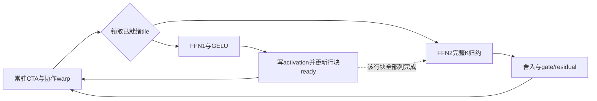

# WAM借鉴MegaMoE思想的tile与常驻调度设计

> 后续设计修订：用户指出整体设计须依据self/cross-attention与FFN，而不能以本页FFN-first局部路线代表Transformer。当前推进顺序和attention契约见[完整Transformer子图设计](ATTENTION-SUBGRAPH-DESIGN.md)。本页保留为此前建议，原实验结果不变。

2026-10-19。本文是综合HW后提出的实施设计，不是新kernel或收益报告。用户确认借鉴MegaMoE的思想，不要求复刻其官方实现。当前完整native baseline冻结，后续仅在optimized中逐步验证。

## 1. 从已有证据确定切入点

M28已解决“完整block是否能用本地原生链替换”的有限复现问题：六个实际30层action query、声明有效KV/metadata/RNG等有限逐位过；两进程动态block九点齐。但当前native仍host顺序launch，包含动态KV长度的D2H同步，不能代表最强shared-prefix/cached/Graph基线。

M26真实cached强基线的带hooks eager profile中，FFN占kernel时长21.9%–29.9%；FFN1+GELU已获得B14完整block约2.45%–3.23%的局部收益。这支持先选FFN子图，不能推断FFN是所有场景的最大热点。旧profile来自前一软件版本，进入性能结论前要核对当前共同强基线，不能把当前动态native慢点算成新调度收益。

已有device FFN1+GELU有限逐位过，device FFN2失败；完整数学链的FFN2用cuBLASLt通过。因此第一阶段不是又造一个完整Transformer，而是把已对齐的数学拆成设备tile任务，找出常驻子图执行的真实增量。

## 2. 执行单元：一张小DAG，固定worker，显式就绪

建议定义一个最小执行上下文：

```text
ExecutionContext
  shape / layer / sigma / dtype / canonical version
  immutable weight pointers
  input / output / full scratch pointers
  candidate→CFG/history row map
  per-row-tile ready counters + generation
  task frontier / completion / terminal status
```

tile任务至少含`op, m_tile, n_tile, logical_offsets, dependency, output_slot, generation`。task不是“一个候选”：M维可跨候选/CFG，因为FFN共享权重且逐行独立；attention必须额外保留CFG/history/private可见性。相邻候选不能因为调度被拼成互相注意的新序列。

常驻CTA是资源与同步容器，内部warp协作完成tile，随后领取下一任务。warp可承担搬运、MMA、epilogue/提交等角色，但SM80上Tensor Core MMA仍需相应warp协作；不先拍脑袋定一个warp独立做完整GEMM。先保持现有协作方式，再单独比较warp分工。



当前`ffn.cu`调用CUTLASS完整GemmKernel，其坐标依赖CUDA的blockIdx。不能简单包一个while循环就得到任意任务调度；需要下沉到显式逻辑tile坐标的MMA/epilogue接口，保留已有K循环、布局和舍入，再接调度器。

## 3. 第一块子图：FFN1 → GELU → FFN2 → gated residual

数学边界固定：

```text
F0[M,3072] BF16
  → GEMM1 + bias → BF16
  → GELU(tanh) → BF16 A[M,14336]
  → GEMM2 + bias → BF16 F2[M,3072]
  → FP32 gate/residual → BF16 Y[M,3072]
```

M32或224；候选3状态的M96只用于后续诊断，现有设备原语尚未准入。先复用已验证的FFN1 CTA64×128×64和原算术，以免同时改变tile、精度和调度无法归因；最终tile选择由测量决定。FFN2不强求同tile或照搬FFN1配置。

**首版用行块级依赖，不从最复杂的K块流水开始。** 对每个m_tile：

1. 多个P任务各完成FFN1的一个N块和GELU，写global activation scratch。
2. P任务完成存储后，以正确发布语义累计该m_tile的ready；计数达到全部FFN1列块时，发布这一行块的FFN2任务。
3. C任务各负责FFN2的一个输出N块，按原完整K顺序归约14336，最后bias及原BF16舍入。
4. 输出tile就绪后完成gate/residual，标记终态。不能延后原FFN2输出舍入来“增加精度”。

这样允许第一个m_tile的FFN2与其余m_tile的FFN1交错，不要求整个FFN1所有行都完成，也不引入新的split-K或跨CTA部分和归并。它保留了清晰的数值检查边界，是比直接跨30层流水更小的可证伪实验。

后续若队列与等待profile支持，再研究MegaMoE式K块ready：某片activation一旦就绪即可供FFN2消费，但必须证明累加顺序/精度与原实现相容。不同K片段不能任意乱序加和。WAM GELU不减半宽度，不能套用SwiGLU的N/2依赖公式。

## 4. 调度原则与死锁边界

首版不需要通用大型运行时、专家路由或复杂work stealing。比较两种最小策略即可：固定tile轮转；有依赖计数的轻量任务派发。优先领取已就绪任务，尚未就绪的任务不得占住所有常驻CTA等待上游。

初版使用完整global activation scratch；B14为6.125MiB，不宣称驻留shared memory。每个worker只在shared/register中保留当前tile及流水缓冲。SM80 CTA之间不共享普通shared memory；跨CTA交换通过global workspace和正确的release/acquire或等效同步。计数归零、代际复用、最终完成与错误终止均需显式协议。

FFN1/FFN2需要的寄存器和shared memory不同，合在一个kernel可能按较大资源需求分配，导致occupancy下降。必须测量“同构阶段常驻”和“异构子图常驻”的差别。若资源合并损失大，保留两个常驻阶段加明确边界比勉强一核更合理。

行块流水也有反作用：交错FFN1/FFN2可能打散相同权重在多个M行块之间的L2复用。需要比较适度成批的phase窗口和过于频繁的交错，不能把队列越动态当成越好。M26现有FFN1原语记录154 registers/thread、73728字节shared memory，理论active CTA/SM=2仅限其实际准入配置；新增角色后要重新量资源，不能从旧值继承occupancy结论。

warp专门化作为独立后续变量：先普通协作worker，再尝试搬运/计算/写回角色。只用A100支持的指令，不照搬SM100的TMA、UMMA、TMEM或cluster。常驻不会让权重全部留在shared，也不保证跨CTA只从HBM读一次；权重复用与L2效果要用实测说明。

## 5. 对完整block如何扩展

FFN原型通过后，下一块才考虑`norm/modulation→projection`。LayerNorm及Q/K RMSNorm需要完整3072维行归约；投影列tile完成不能直接发下游RMSNorm。RoPE、self attention、跨候选合法history/private以及cache提交都有自己的依赖边界，不能当作独立token小任务任意跨层推进。

共享history attention作为另一个有条件组件：只按相同CFG/历史/条件分组query tile，公共prefix与private suffix按正确softmax统计合并，核对现有shared-prefix已经实现的部分。减少CTA可能抵消历史复用，必须比较query分组、KV split与occupancy；不预设全部合并最好。

context K/V缓存、CUDA Graph、静态workspace属于共同强基线。第一版可以是一小段persistent子图加现有attention/GEMM边界；目标是可测的新增执行组织，不要求所有30层或整个block一次launch。

Graph强baseline已经消除一部分host launch成本；6.125MiB activation的实际L2命中和DRAM往返也不能仅按tensor大小推断。persistent需要用设备任务等待、实际流量或更好的尾波/计算重叠证明增量，不能只拿更少的launch数量作结论。

## 6. 如何证明是调度收益

| 对照 | 保持相同 | 单独改变 |
|---|---|---|
| E0 最佳既有路径 | 同query/权重/条件/缓存生命周期 | 作为强baseline |
| E1 tile顺序执行 | 相同数值、同工作量，准备成本计入 | 换成可设备执行的tile原语 |
| E2 常驻worker | E1同tile/归约/epilogue | 常驻取任务，先无新增warp专门化 |
| E3 子图依赖/warp策略 | 数值与算法保持 | 行块DAG流水、角色专门化逐项增加 |

shape取1/3/7候选、短中长KV；未实现的点明确NA。若E2比E1差，先看任务管理/尾波/资源，不用减少精度补速度。若B2/B14同等收益，可以称通用优化；只有交互证据支持时才称投机放大了可调度性。FFN里没有天然必须“候选感知”的数学，不能把普通行分组改名就作为创新。

先看子图和完整block，继而30层verifier；进入round后主指标为ΣT_round/Σg，完整chunk与闭环质量另验。profile时长不进入正式表。SR、长尾与失败罚分不被平均性能遮盖，原四项false和所有历史FAILED不变。

## 7. 现在应当做的下一步

先实现**显式tile坐标的FFN1+GELU worker与静态常驻调度**，同时对照原K循环核查FFN2数值差异；用最小的三层对照E0/E1/E2判断队列是否有价值。随后才把FFN2和行块DAG接入。原因是这一步具备已有原语和清晰对照，不必先承担完整block或30层的全部同步风险。

初版开发筛选上限沿用建议：最多两个工作日、≤7 GPU生命周期小时，实际GPU作业启动前另登记输入/绝对截止/存储/清理；M30本身GPU预算0。若FFN2严格门无法保持，停止完整FFN集成，不用历史allclose门放行。若30层相对强B14的新增改善不足约5%或完整chunk不足约3%且接近噪声，停止扩大融合并收缩主张。

完整依赖与日期见[工作大纲](WORK-OUTLINE.md)；真实接口见[协作交接](HANDOFF.md)。
