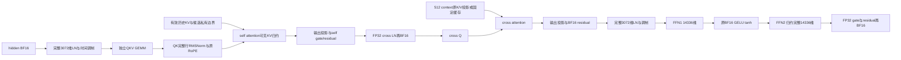

# 真实block契约与依赖

科研base `ca5f37e0482c2e38e3738e3d8e71e3b185990a23`；完整机器清单见[block_contract.json](block_contract.json)、参数来源见`attempts/cpu-real-block-final/BLOCK-PARAMETERS.json`、源hash/函数行号见[SOURCE-MANIFEST](SOURCE-MANIFEST.json)。

OBSERVED：WanTransformerBlock，dim3072、H24、head128、FFN14336，cross_attn_norm=true、eps=1e-6。27项参数全部BF16；原config attn_mode=flex，但真实server显式以LINGBOT_ATTN_MODE默认torch覆盖（wan_va_server.py:264–275），本轮AST原类也只准入torch分支。未导入整个server/编译Flex/加载全模型。

R0直接调用固定AST原forward。B0复制原运算组织、共享同一参数对象、eval/inference，autocast关闭；norm1/3为非affine FP32LayerNorm，norm2为affine FP32LayerNorm；QK为跨3072维RMSNorm后unflatten为H24/D128。FFN是Linear→GELU(approximate=tanh)→Dropout(0)→Linear。

| Linear | B2逻辑M | B14逻辑M | N | K |
|---|---:|---:|---:|---:|
| self Q/K/V/out，cross Q/out | 32 | 224 | 3072 | 3072 |
| cross context K/V | 1024 | 7168 | 3072 | 3072 |
| FFN1 | 32 | 224 | 14336 | 3072 |
| FFN2 | 32 | 224 | 3072 | 14336 |

以上是实际CPU模块输入/权重几何；观察到可零copy view为[M,K]。保存后的主输入stride为[B×Q,Q,D]对应的连续stride，线性weight为[N,K]连续；leading row stride为K（FFN2为14336）。**实际CUDA GEMM调用、kernel和tile仍UNKNOWN**；CPU前端观察不替代GPU profile。当前ATen mode未观察到内部addmm/bmm，不补造派发证据。

CFG行映射是[0×7,1×7]。每个candidate独立Q16、私有16个K/V，历史来自对应CFG的B2有效prefix272/1136/2144；不能描述成跨候选Q112/224 attention序列。B0原B14仍执行history gather/index_select/cat，不声称共享prefix优化或只读HBM一次。context为[batch,512,3072]，原block无cross投影缓存；静态适配只固定同一context对象与原shape。

显式边界：temb和调制FP32；norm1/2/3先FP32，调制后回BF16；self residual先FP32再BF16；cross residual按原BF16相加；FFN projection与GELU之间保留BF16舍入；FFN final gate/residual先FP32再BF16。RoPE保持原FP64→complex乘法→BF16，freq输入complex64。不更换激活/norm/归约顺序。

norm/RMSNorm消费者需完整行归约完成；attention需对应candidate/head完整合法可见KV；输出投影需其K维完整归约；FFN2某行最终结果需14336维activation reduction，不能FFN1任意N tile刚完成就发布最终ready。流水可研究行组/中间tile，但尚无device实现、同步或收益证明。

生命周期：原权重只读全程共享；六个时间调制分量view同一table；QKV与RoPE临时值服务本次attention，private不写B14历史；self/cross residual用完即释放额外Python引用；FFN1 expansion在GELU完成后释放，GELU/Dropout结果在FFN2后释放。debug tap保存快照会延长生命周期，只用于诊断，计时必须关闭。

只读B14应保持全部metadata/有效KV；B2 update0按原helper暂写无效槽并restore mask，无效槽id/is_pred可能合法变动，不当作有效KV污染。update1/2比较完整最终metadata和有效KV，不要求写后不变。原helper在空间不足时会驱逐，不能从当前有空槽的六fixture推广为所有容量下只读无副作用；驱逐只在标明SYNTHETIC_ONLY分支控制中比较等价。

原捕获`.cpu().contiguous()`已丢原CUDA layout/alias；本轮不声称恢复它。可变cache每臂独立，read-only参数共享；当前CPU RNG逐位恢复/保持不代表原采集时CUDA RNG已保存。所有这些缺口保留在JSON。

参考方法：[PyTorch2.9数值说明](https://docs.pytorch.org/docs/2.9/notes/numerical_accuracy.html)说明设备/批处理数值可不同；[Linear](https://docs.pytorch.org/docs/2.9/generated/torch.nn.Linear.html)与[LayerNorm](https://docs.pytorch.org/docs/2.9/generated/torch.nn.LayerNorm.html)仅支持API解释，不替代本地执行证据。
