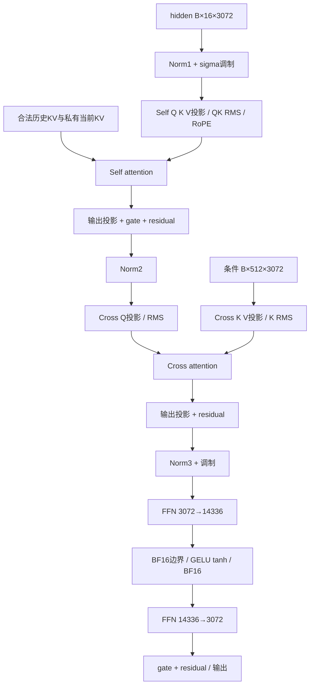

# 当前单层persistent算子：按真实源码阅读

主源码完整路径：`/rjs/cxz/论文探索/算子研究/wam_ops/optimized/csrc/whole_layer.cu`。Python入口：`/rjs/cxz/论文探索/算子研究/wam_ops/optimized/whole_layer.py`。远端部署对应 `/root/cxz/ops/persistent-tile-20261019/workspace/算子研究/wam_ops/optimized/`。baseline冻结，本轮只在实验namespace生成一个诊断副本；没有替换主源/DSO。

这个版本已经覆盖完整一层，但原逐位与性能验收没有通过。“一次调用一个kernel”是结构事实，不是速度保证。

## 输入、输出和依赖

action hidden输入/输出 `[B,16,3072]` BF16，B=2或14；text/condition `[B,512,3072]`；temb通常`[B,16,6,3072]`，还支持长度1广播；RoPE `[B,16,1,64]` complex64。另有合法KV pool、有效slot/id/mask及candidate→CFG历史行映射。H24、每head128、FFN14336。112维action latent是block外表示，不能拿它代替3072隐藏维。



上图是数学依赖；实际kernel按29个粗阶段顺序执行。中间张量都分配在global workspace，尚未把图中相邻tile驻留起来流水执行。

## 入口做什么

[whole_layer.py:33](../../../算子研究/wam_ops/optimized/whole_layer.py#L33)绑定原参数别名、当前cache和调用参数，然后进入C++ forward。[C++:370](../../../算子研究/wam_ops/optimized/csrc/whole_layer.cu#L370)检查dtype/形状、分配workspace、计算可驻留CTA数，最后[L425](../../../算子研究/wam_ops/optimized/csrc/whole_layer.cu#L425)执行一次cooperative launch。host不做GEMM，device也不启动子kernel。

[whole_layer:329](../../../算子研究/wam_ops/optimized/csrc/whole_layer.cu#L329)是主流程。每一步`linear/norm/point/attention`是同一个kernel里的device函数，不是一个新CUDA launch。

## persistent执行粒度

本卡实际108个常驻CTA，每CTA256线程、8warp。warp0中的thread0从当前stage的全局计数器atomicAdd领取一个tile；其余warp协作完成这个CTA tile。

| warp | 固定职责 |
|---|---|
| 0 | tile领取、metadata；并非32条lane都在调度 |
| 1 | activation或Q加载 |
| 2 | weight或KV加载 |
| 3–6 | Tensor Core / norm / softmax / pointwise |
| 7 | epilogue、舍入、结果写回 |

**任务领取单位是CTA，并非每个warp独立从ready队列领取任意算子。** 目前warp分工是固定角色。stage开始和结束要全grid同步，没有一个CTA提前执行下一stage的consumer。这与细粒度生产者消费者调度还有距离。

## GEMM tile怎样跑

[gemm_tile:79](../../../算子研究/wam_ops/optimized/csrc/whole_layer.cu#L79)给每CTA一个64×64输出块；四个compute warp各负责32×32。K轴每次32，用WMMA 16×16×16做内部计算。

```text
for K每32个元素:
    warp1加载A，warp2加载W到同一组shared buffer
    全CTA同步
    warp3..6执行WMMA
    全CTA同步，才可覆盖buffer
warp3..6将累加器写shared
同步 → warp7加bias并舍入BF16写global → 同步
```

当前没有cp.async多缓冲，不能让下个K块加载与当前MMA并行。线程有不同职责，但不是持续重叠的流水。FFN2的K14336导致448轮这样的循环。B2 action M32只用M64 tile的一半行；B14 M224填入256行容量。

对应真实矩阵：self/cross Q和输出投影`M=32/224,N=K=3072`；cross K/V`M=1024/7168,N=K=3072`；FFN1 N14336，FFN2 K14336。当前大cross K/V仍每次计算，未使用已有强baseline中的静态条件投影缓存。

## attention tile怎样跑

[attention_tile:264](../../../算子研究/wam_ops/optimized/csrc/whole_layer.cu#L264)的一个CTA负责一个candidate、一个head、16个query，循环处理64个KV：加载KV→QK→softmax→PV→在线输出合并。每项之间都有CTA同步。softmax目前只有16个线程逐行串行扫64个score，加载与MMA也没有双缓冲重叠。

B14是14个独立Q16实例，包含7候选×2CFG；没有变成可跨候选互相注意的Q112，也没有共享private KV。公共prefix以合法候选到CFG历史映射读取，本版没有CTA内跨候选公共KV复用。原FlashAttention B2路径还会split-K并合并，本版attention没有相同的KV并行。

## 当前差距与下一顺序

本轮完整block慢5.09–11.14倍；插桩副本GEMM61%–84%，长KV self-attention约25%；改为静态领取没有改善。细表和计时限制见[RESULT](RESULT.md)。这支持先修GEMM/attention内部数据通路，再投入更复杂队列；不能从这些观察断言persistent思想不可行，也不能承诺优化后必胜。

下一阶段优先对真实矩阵设计有重叠的SM80 GEMM tile与数值验证；其后做attention行归约/加载流水，建立同缓存条件的强对照。只在基本tile质量和成本成立后继续跨阶段ready调度。原Torch数值门和baseline冻结始终保留。
